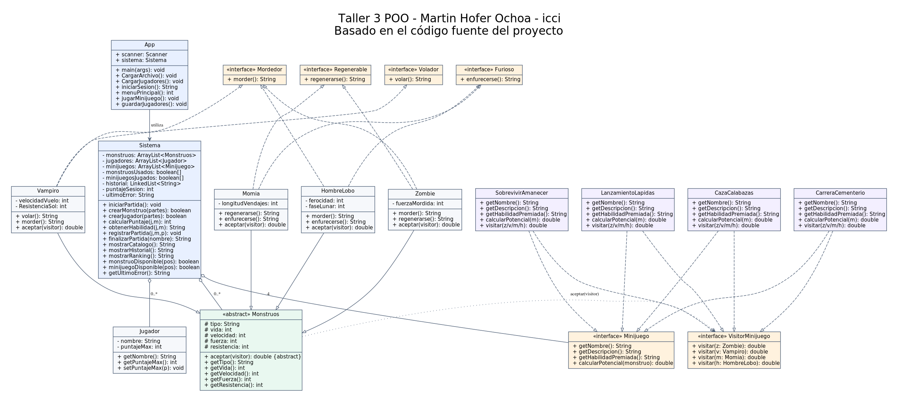

# Taller 3 POO - Martin Hofer Ochoa - ICCI

## 🎃 Spooky Season

**Asignatura:** Programación Orientada a Objetos (POO)  
**Carrera:** Ingeniería Civil en Computación e Informática  
**Universidad:** Universidad Católica del Norte (UCN)  
**Estudiante:** Martin Hofer Ochoa  
**RUT:** 22.368.055-0  
**Lenguaje:** Java  
**Usuario GitHub:** [@mrtinzinn](https://github.com/mrtinzinn)

---

## 📖 Descripción del proyecto

Spooky Season es un juego desarrollado en Java que permite a los usuarios participar en diferentes minijuegos utilizando monstruos con características y habilidades especiales.

El objetivo es conseguir la mayor cantidad de puntos posible, seleccionando estratégicamente los monstruos según sus atributos y las habilidades premiadas en cada minijuego.

El programa utiliza conceptos de Programación Orientada a Objetos, como herencia, polimorfismo, clases abstractas, interfaces y el patrón de diseño Visitor.

## 👾 Monstruos disponibles

El juego cuenta con cuatro tipos de monstruos:

- **Zombi:** posee fuerza de mordida y habilidades de regeneración.
- **Vampiro:** posee velocidad de vuelo y resistencia al sol.
- **Momia:** posee longitud de vendajes y habilidades especiales de regeneración y furia.
- **Hombre Lobo:** posee ferocidad y una fase lunar que influye en sus capacidades.

Todos los monstruos comparten atributos generales:

- Vida
- Velocidad
- Fuerza
- Resistencia

Cada tipo de monstruo posee atributos adicionales que influyen en su desempeño durante los minijuegos.

## 🎮 Minijuegos

El sistema cuenta con cuatro minijuegos:

### 1. Carrera del Cementerio

Los monstruos compiten utilizando sus capacidades de velocidad y desplazamiento.

**Habilidad premiada:** Volador.

### 2. Caza de Calabazas

Los monstruos utilizan sus capacidades físicas para obtener el mejor resultado.

**Habilidad premiada:** Mordedor.

### 3. Lanzamiento de Lápidas

Los monstruos utilizan su fuerza y características especiales para obtener puntos.

**Habilidad premiada:** Furioso.

### 4. Sobrevivir al Amanecer

Los monstruos deben aprovechar sus capacidades de resistencia y supervivencia.

**Habilidad premiada:** Regenerable.

Cada minijuego puede jugarse una sola vez por sesión. Además, cada monstruo puede utilizarse solamente una vez durante la misma sesión.

## 🏆 Sistema de puntuación

El puntaje obtenido depende del potencial calculado para el monstruo seleccionado en cada minijuego.

La fórmula utilizada es:

**Puntaje = redondear(Potencial × 10 × Multiplicador)**

El multiplicador depende de la habilidad del monstruo:

- **1.5:** si posee la habilidad premiada por el minijuego.
- **1.0:** si no posee dicha habilidad.

Los puntajes se acumulan durante la sesión. Al finalizar, el sistema compara el resultado con el récord anterior del jugador y conserva el puntaje más alto.

## 📋 Funcionalidades principales

El programa permite:

1. Iniciar sesión ingresando un nombre de jugador.
2. Seleccionar y jugar uno de los cuatro minijuegos.
3. Elegir un monstruo disponible.
4. Calcular el potencial y puntaje obtenido.
5. Consultar el catálogo de monstruos.
6. Visualizar el historial de partidas.
7. Consultar el ranking de jugadores.
8. Finalizar la sesión y guardar el récord.
9. Iniciar una nueva sesión o salir del programa.

## 📂 Estructura del proyecto

El proyecto está organizado principalmente dentro del paquete `taller03`, que contiene las clases e interfaces necesarias para el funcionamiento del juego.

```text
Taller3_POO/
├── src/
│   └── taller03/
│       ├── App.java
│       ├── Sistema.java
│       ├── Jugador.java
│       ├── Monstruos.java
│       ├── Zombie.java
│       ├── Vampiro.java
│       ├── Momia.java
│       ├── HombreLobo.java
│       ├── Minijuego.java
│       ├── VisitorMinijuego.java
│       ├── CarreraCementerio.java
│       ├── CazaCalabazas.java
│       ├── LanzamientoLapidas.java
│       ├── SobrevivirAmanecer.java
│       ├── Mordedor.java
│       ├── Volador.java
│       ├── Furioso.java
│       └── Regenerable.java
├── txt/
│   ├── Monstruos.txt
│   └── Registros.txt
├── README.md
└── Taller_3_POO_Martin_Hofer_Ochoa_UML.png
```

### Clases principales

**App.java:** contiene el método `main()`, los menús, la interacción con el usuario, la lectura de archivos y el guardado de registros.

**Sistema.java:** administra los monstruos, jugadores y minijuegos. También controla las sesiones, calcula puntajes, registra partidas y genera el ranking.

**Jugador.java:** representa a cada jugador y almacena su nombre y puntaje máximo.

**Monstruos.java:** clase abstracta que contiene los atributos generales de los monstruos.

**Zombie.java, Vampiro.java, Momia.java y HombreLobo.java:** clases que heredan de `Monstruos` y poseen atributos y habilidades específicas.

**Minijuego.java:** interfaz que define las operaciones comunes de los minijuegos.

**VisitorMinijuego.java:** interfaz utilizada para implementar el patrón de diseño Visitor.

**CarreraCementerio.java, CazaCalabazas.java, LanzamientoLapidas.java y SobrevivirAmanecer.java:** clases que implementan los minijuegos y calculan el potencial de cada monstruo.

**Mordedor.java, Volador.java, Furioso.java y Regenerable.java:** interfaces que representan las habilidades especiales de los monstruos.

## 💻 Conceptos de Programación Orientada a Objetos

En el desarrollo del proyecto se aplicaron los siguientes conceptos:

- **Encapsulamiento:** utilización de atributos privados y métodos de acceso.
- **Herencia:** las clases de monstruos heredan de la clase abstracta `Monstruos`.
- **Polimorfismo:** permite trabajar con diferentes tipos de monstruos mediante una referencia común.
- **Interfaces:** representan habilidades especiales y comportamientos compartidos.
- **Clases abstractas:** permiten definir características comunes para las clases derivadas.
- **Patrón Visitor:** permite calcular el potencial de cada monstruo según el minijuego sin concentrar todas las fórmulas en una sola clase.

### Estructuras de datos utilizadas

- `ArrayList`: almacenamiento de monstruos, jugadores y minijuegos.
- `LinkedList`: almacenamiento del historial de partidas.
- Arreglos de booleanos: control de monstruos utilizados y minijuegos completados.

## 📄 Archivos de datos

El programa utiliza dos archivos de texto ubicados en la carpeta `txt`.

### Monstruos.txt

Contiene los monstruos disponibles, sus tipos y atributos.

Los datos están separados mediante punto y coma (`;`).

### Registros.txt

Almacena los nombres de los jugadores y sus mejores puntajes.

Formato:

```text
Nombre;PuntajeMaximo
```

El sistema permite cargar los registros existentes y actualizar los récords cuando termina una sesión.

## 🛡️ Validaciones

El programa incorpora diferentes validaciones para evitar errores durante su ejecución:

- Verificación de tipos de monstruos válidos.
- Validación de la cantidad de atributos por registro.
- Comprobación de rangos permitidos.
- Detección de datos no numéricos.
- Validación del nombre del jugador.
- Control de opciones incorrectas del menú.
- Prevención de reutilización de monstruos.
- Prevención de repetición de minijuegos.
- Manejo de archivos inexistentes.

## ⚙️ Instrucciones de ejecución

### Requisitos

- Java JDK compatible con el proyecto.
- Eclipse IDE o un entorno de desarrollo compatible con Java.

### Pasos para ejecutar

1. Descargar o clonar el repositorio de GitHub.
2. Abrir Eclipse IDE.
3. Seleccionar **File → Import → General → Existing Projects into Workspace**.
4. Seleccionar la carpeta del proyecto descargado.
5. Finalizar la importación.
6. Verificar que la carpeta `txt` contenga los archivos `Monstruos.txt` y `Registros.txt`.
7. Abrir `App.java` dentro del paquete `taller03`.
8. Ejecutar mediante **Run As → Java Application**.
9. Seguir las instrucciones del menú en consola.

**Importante:** el programa utiliza rutas relativas para leer y guardar archivos, por lo que debe ejecutarse con la carpeta principal del proyecto como directorio de trabajo.

## 🏗️ Diagrama de clases UML

El diagrama de clases representa la estructura del sistema y las relaciones entre sus componentes.

Incluye las clases principales, las clases derivadas, las interfaces y sus relaciones de herencia, implementación y asociación.



## 👨‍💻 Autor

**Martin Hofer Ochoa**  
**RUT:** 22.368.055-0  
**GitHub:** [@mrtinzinn](https://github.com/mrtinzinn)  
**Carrera:** Ingeniería Civil en Computación e Informática  
**Universidad:** Universidad Católica del Norte

---

**Proyecto académico — Taller 3 de Programación Orientada a Objetos.**
